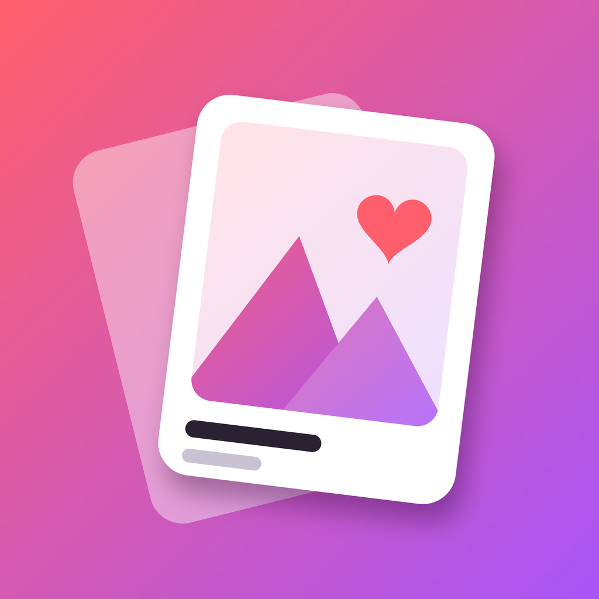

<p align="center"></p>

# Image Date

Swipe through a folder of images like a dating app, three times (or as many times as you want).
What is left is the set you really like.

- **Right** = keep. **Left** = pass. **Up** = Super Like (round 1 only).
- **Round 1** shows all images. **Round 2** shows only the images you kept in round 1.
  **Round 3** shows only the images you kept in round 2.
- A **Super Like** means "I want this for sure". The image goes straight to the final set and
  skips rounds 2 and 3.
- **Final set** = Super Likes + images kept in round 3. Example: 1,000 → 250 → 200 → 185.
- **Endless** mode: the rounds do not stop at 3. Each round shows the images you kept in the round
  before, until you tap **Stop**. Example: 1,000 → 250 → 200 → 120 → 60 → 40 · Stop.

Image Date runs on iPhone and Windows. It works offline: no account, no server, no analytics.
It never deletes or moves your images.

## Using the app

| Action | iPhone | Windows |
|---|---|---|
| Keep | Swipe right, or ♥ | Drag right, ♥, or → |
| Pass | Swipe left, or ✕ | Drag left, ✕, or ← |
| Super Like (round 1) | Swipe up, or ★ | Drag up, ★, or ↑ |
| Undo last swipe | Shake the phone, or ↺ | Ctrl+Z, Backspace, or ↺ |
| Zoom | Pinch, or double-tap | Mouse wheel, double-click, Space or Z |
| See the whole image | Press and hold the card | Press and hold the card |
| Image info | ⓘ | ⓘ or I |
| Stop and review | ⚑ | ⚑ or S |
| Hide the buttons (sideways) | Tap the image | Click the image |

Only the last swipe can be undone.

**Projects.** Each project has its own images and its own progress. You can have many projects
at the same time. The app saves after each swipe, so you can stop at any time and continue later.

**3 rounds or Endless.** Choose on the New project screen.

| | 3 rounds | Endless |
|---|---|---|
| Rounds | 1, 2, 3, then the final set | 1, 2, 3, 4... until you stop |
| Super Like | Skips rounds 2 and 3 | Skips all later rounds |
| End | After round 3, or when no image is left | When you tap Stop, or when no image is left |

**Stop and review** (⚑ on the swipe screen, ⋯ menu, the round screen, or S) works in both modes,
also in the middle of a round. It opens the picks screen with every image still in the running:
the Super Likes, the images you kept in this round, and the images you did not swipe yet in this
round. From there:

- **Continue round N** goes back to the cards where you stopped.
- **Keep going · round 4** (a finished 3-round project) turns the project into Endless and starts
  round 4 with your final set.
- Export, or remove images from the picks, as at the end.

**Adding images.** New project › Add images from:

| Source | Platform | Copies? |
|---|---|---|
| Photos albums (one or more) | iPhone | No. The app keeps the photo ids. |
| Folder in Files (iCloud Drive, On My iPhone, USB drive) with subfolders | iPhone | No. The app keeps a link to the folder. |
| Folder with subfolders | Windows | No. |
| Single image files | iPhone | Yes, a copy in the app (iOS gives only copies). |
| Single image files | Windows | No. |

Formats: JPG, PNG, GIF, WebP, BMP everywhere; also HEIC, HEIF, AVIF, TIFF and DNG on iPhone.
You can add more images to a project during round 1 (project menu › Add images). For a folder,
"Look for new images" adds files that are new in that folder.

**Order.** Shuffle (default), name A–Z or Z–A, newest or oldest first, largest or smallest file
first. Change it on the round screen or in the ⋯ menu. "Shuffle again" makes a new random order.

**The final set.** At the end, the project shows only your picks: the folder "cleaned out",
while your files stay where they are. From there:

- **Save to a Photos album** (iPhone): makes the album "Image Date · *project*". Photos from your
  library are added to the album, not copied. Images from files are saved to Photos first.
- **Copy to a folder**: copies the picks into a new folder "*project* picks" in the folder you
  choose.
- Tap a pick to see it big. ♡̸ removes it from the picks.

**Settings.** Dark (default), Light or System theme. How landscape images show while the phone
is upright: show the whole image (default), fill the card, or turn the image sideways. Fill the
screen when the phone is sideways (default on). Shake to undo and haptics (iPhone).

## Install on iPhone (AltStore, Windows PC, free)

The same setup as Bookscroll. If AltStore is already on your iPhone, skip to step 7.

**Get the app file.** Every push builds the apps on GitHub. They are on the release
**[latest](../../releases/tag/latest)**: `ImageDate.ipa` (iPhone) and `ImageDate-Windows.zip`.
To build again by hand: Actions › **Build apps** › Run workflow. It takes about 15 minutes.

**On the Windows PC (one time):**

1. Install **iTunes** and **iCloud** from apple.com (the download links on Apple's pages, not
   the Microsoft Store versions).
2. Install **AltServer** from altstore.io and start it. Its icon is in the system tray (click
   the ^ arrow near the clock).
3. Connect the iPhone with a cable. Unlock it and tap **Trust**. In iTunes, select the phone
   and turn on **Sync with this iPhone over Wi-Fi**, then **Apply**.
4. AltServer tray icon › **Install AltStore** › your iPhone. Sign in with your Apple ID.

**On the iPhone (one time):**

5. Settings › General › VPN & Device Management › your Apple ID › **Trust**.
6. Settings › Privacy & Security › **Developer Mode** › On. The phone restarts; confirm
   **Turn On**.

**Install Image Date:**

7. In Safari, open this repository › Releases › **Image Date** and tap **ImageDate.ipa**.
   Tap **Download**.
8. Open **AltStore** › My Apps › **+** (top left) › Downloads › `ImageDate.ipa`. Wait until it
   shows in My Apps, then open Image Date from the home screen.

| Fact | Detail |
|---|---|
| 7-day renewal | A free Apple ID signs apps for 7 days. AltStore renews them when the PC is on, AltServer runs, and the phone is on the same Wi-Fi. AltStore › My Apps › **Refresh All** renews by hand. |
| If it expires | Image Date does not open until you refresh it. Your projects stay. |
| App limit | A free Apple ID allows 3 sideloaded apps at a time. AltStore counts as one. Image Date has no extensions, so it counts as one. |
| Update | Download the new `ImageDate.ipa` and open it in AltStore. Your projects stay. |
| SideStore | sidestore.io installs the same `.ipa` and renews it from the phone. |

## Install on Windows

1. Open the release **[latest](../../releases/tag/latest)** and download `ImageDate-Windows.zip`.
2. Unzip it anywhere (for example `Documents\Image Date`).
3. Open `ImageDate.exe`. The app is not signed, so Windows SmartScreen can show "Windows
   protected your PC": click **More info** › **Run anyway**. This happens one time.

To update, replace the folder with the new one. Projects are kept in
`%APPDATA%\Image Date\Image Date`, not in the app folder.

## Where the data is

| Data | Place |
|---|---|
| Projects and swipes | App storage (iPhone: the app's Application Support folder; Windows: `%APPDATA%\Image Date\Image Date`). One JSON file per project. |
| Your images | Not changed. Folders are read in place; Photos are read by id. |
| Copies | Only "Image files" on iPhone. Deleting the project deletes these copies. |

Deleting a project deletes only its swipes (and the copies above), never your images.

## For developers

Flutter 3.47.9 (Dart 3.13), one codebase for iOS and Windows.

```sh
flutter pub get
flutter analyze
flutter test
flutter run -d windows        # on Windows
flutter build ios --no-codesign   # on a Mac
```

| Path | What |
|---|---|
| `lib/core/` | Data model, the round rules (3 rounds and Endless), sort orders, storage. No Flutter UI. |
| `lib/platform/` | Image loading (downsampled to screen size), imports, export, iOS channel. |
| `lib/ui/` | Screens. `ui/swipe/swipe_deck.dart` is the card stack and its gestures. |
| `ios/Runner/AppDelegate.swift` | Native iOS part: Files folder picker with bookmarks, iCloud downloads, HEIC/AVIF decoding through ImageIO. |
| `tool/make_icon.py` | Draws the app icon (Pillow) for iOS and Windows. |
| `.github/workflows/build.yml` | Tests, then builds `ImageDate.ipa` (macOS runner) and `ImageDate-Windows.zip` (Windows runner) and puts them on the release `latest`. |

Large images: the swipe cards decode each image to about the screen size (at most 3072 px on the
long side) and decode the next three images early. Zoom loads up to 4096 px.
